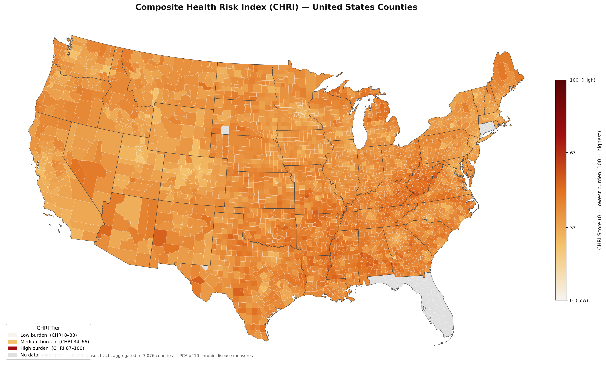
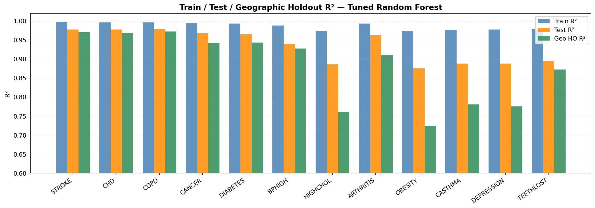
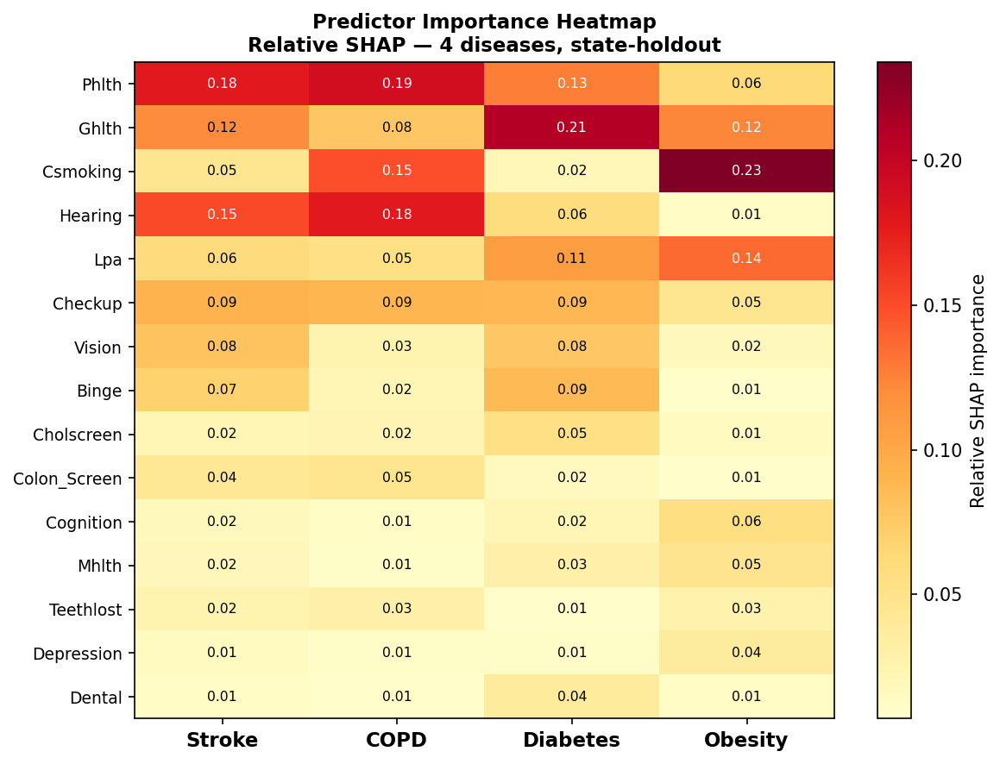
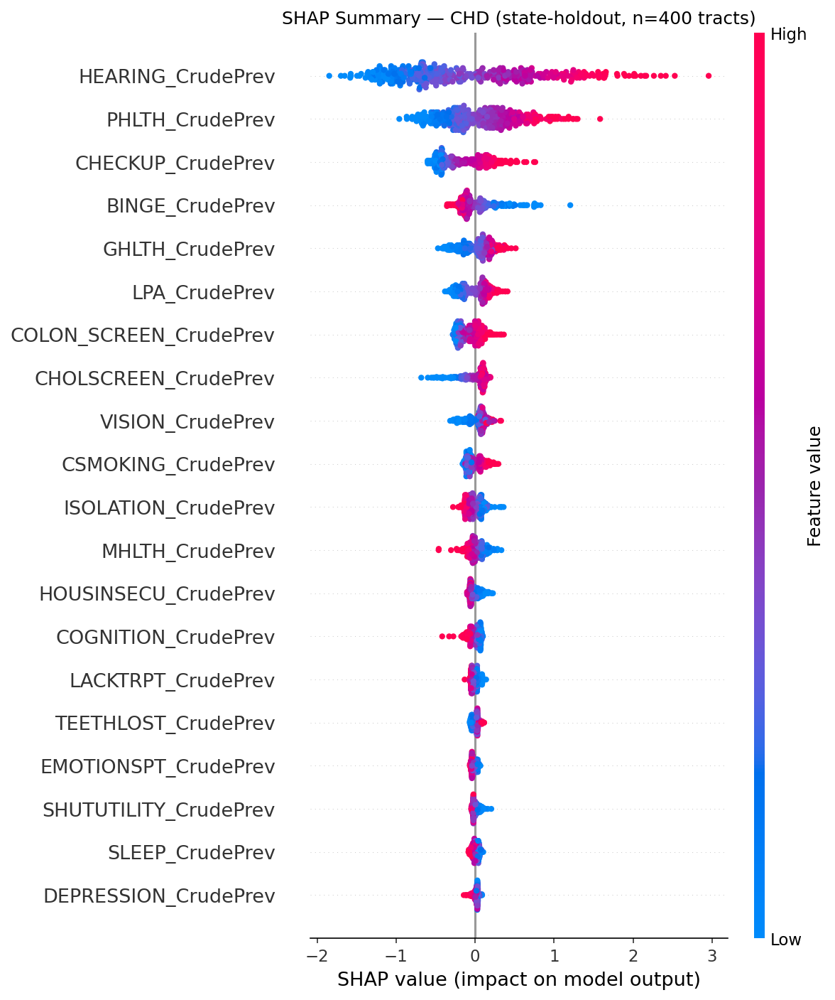
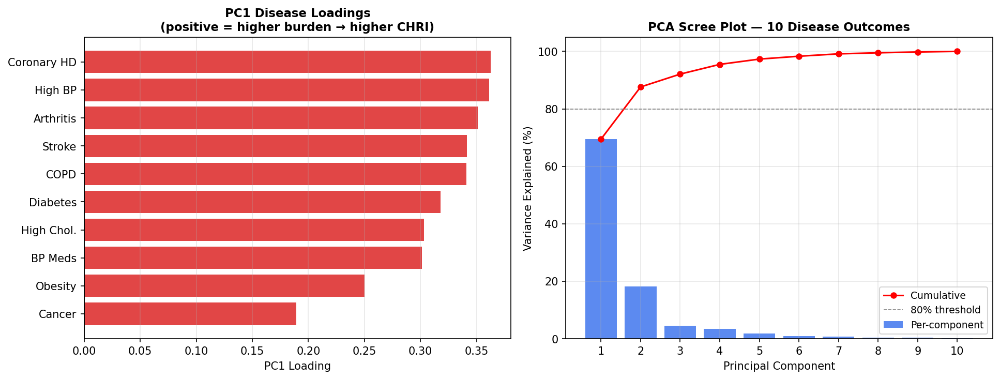
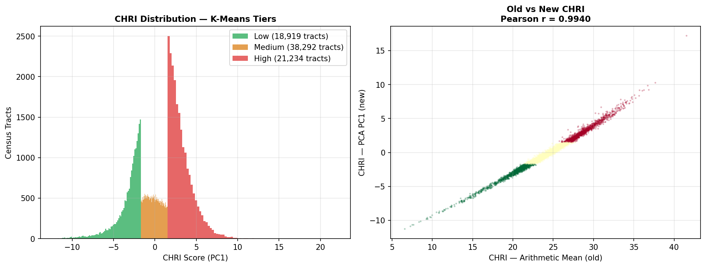
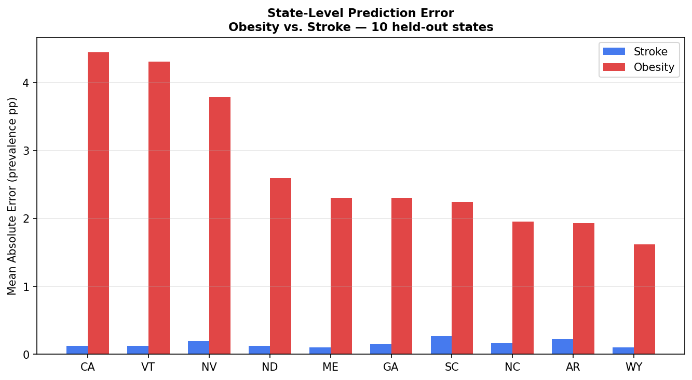
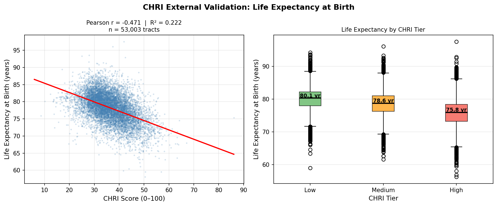
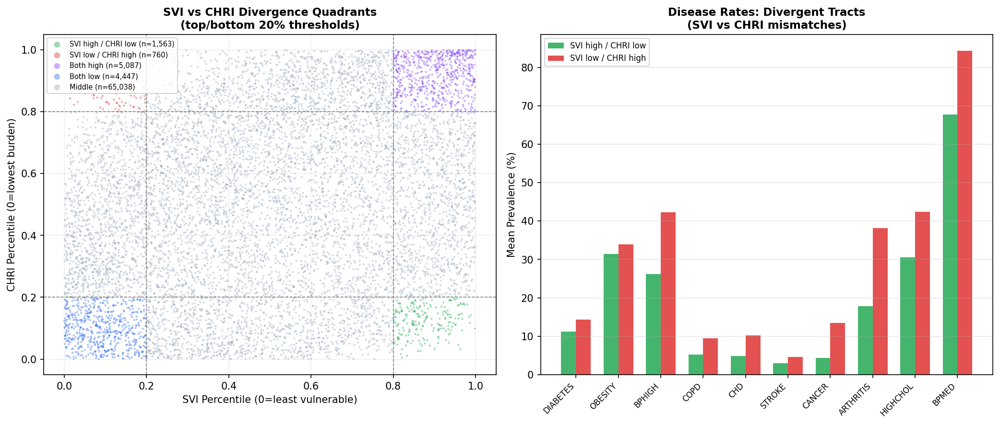

# Chronic Disease Burden Mapping & Prediction

**A Machine-Learning & Spatial Analysis Study of 10 Chronic Diseases Across 78,445 US Census Tracts**

> CDC PLACES 2024 · Composite Health Risk Index (CHRI) · XGBoost / SHAP · 7-Model Peer Review

[](LICENSE)

**Venu Bandi** · MPS Data Science, UMBC · [venubandi3060@gmail.com](mailto:venubandi3060@gmail.com)  
Live interactive map → [venubandi.github.io/cdc-chronic-health-risk](https://venubandi.github.io/cdc-chronic-health-risk)

---

## Table of Contents

1. [Introduction](#1-introduction)
2. [Phase 1 — Dataset Baseline & Audit](#2-phase-1--dataset-baseline--audit)
3. [Phase 2 — Research Gap & Study Design](#3-phase-2--research-gap--study-design)
4. [Data & Methods — Predictors & Pipeline](#4-data--methods--predictors--pipeline)
5. [ML Prediction Results — All 10 Diseases](#5-ml-prediction-results--all-10-diseases)
6. [SHAP Explainability — Disease Drivers](#6-shap-explainability--disease-drivers)
7. [Composite Health Risk Index (CHRI)](#7-composite-health-risk-index-chri)
8. [PCA Diagnostics](#8-pca-diagnostics)
9. [Spatial Autocorrelation](#9-spatial-autocorrelation)
10. [External Validation — Life Expectancy](#10-external-validation--life-expectancy)
11. [Age Confounding — Direct ACS 2022 Test](#11-age-confounding--direct-acs-2022-test)
12. [SVI Divergence — The 760 Missed Communities](#12-svi-divergence--the-760-missed-communities)
13. [7-Model Independent Peer Review](#13-7-model-independent-peer-review)
14. [Key Limitations](#14-key-limitations)
15. [Conclusion](#15-conclusion)

---

## 1. Introduction

Chronic diseases — diabetes, heart disease, stroke, COPD, cancer, obesity, hypertension, arthritis, and hypercholesterolemia — account for 7 in 10 US deaths and consume more than 75% of the nation's $4.1 trillion annual healthcare expenditure. Their geographic distribution is profoundly unequal: some census tracts carry disease rates two to three times the national average, while neighboring tracts carry near-average burden.

Standard resource-allocation tools such as the **Social Vulnerability Index (SVI)** capture socioeconomic deprivation, but deprivation and disease burden do not perfectly overlap — leaving identifiable communities underserved.

This study uses **CDC PLACES 2024**, a 78,445-tract dataset of model-based chronic disease prevalence estimates derived from BRFSS via Multilevel Regression and Poststratification (MrP), to:

1. Build **state-holdout validated XGBoost models** predicting each of 10 disease rates
2. Construct a **Composite Health Risk Index (CHRI)** via PCA that ranks every census tract by shared chronic disease burden
3. Apply **SHAP explainability** to identify the behavioral and social drivers of each disease
4. Identify **communities where disease burden diverges** from what standard deprivation tools predict

| Metric | Value |
|---|---|
| Census tracts | 78,445 |
| Chronic diseases modeled | 10 |
| Predictors | 27 |
| Cancer state-holdout R² | 0.9454 |
| Best model (COPD) R² | 0.9664 |


*Figure 1. CHRI scores aggregated to county level across the contiguous US. Deep red = highest chronic disease burden (Deep South, Appalachia). Source: CDC PLACES 2024, 78,445 tracts.*

---

## 2. Phase 1 — Dataset Baseline & Audit

### 2.1 Dataset Provenance

| Item | Detail |
|---|---|
| Dataset | CDC PLACES: Local Data for Better Health (2024 release) |
| Geographic unit | Census tract (11-digit FIPS) |
| Underlying survey | Behavioral Risk Factor Surveillance System (BRFSS) |
| Estimation method | Multilevel Regression and Poststratification (MrP) |
| Approximate data year | 2021–2022 BRFSS survey data |
| ACS supplement | ACS 5-year estimates for small-area denominators |
| Total tracts in release | 83,522 |
| Tracts with complete data | 78,445 (93.9% — used in all modeling and PCA) |
| Tracts excluded | 5,077 (6.1%) — missing BPHIGH, HIGHCHOL, and BPMED |
| States / jurisdictions | 51 (all 50 states + DC) |
| Counties represented | 3,143 |

### 2.2 Missingness Audit

**6,627 tracts (7.9%)** are excluded from the divergence analysis due to missing SVI linkage data, with 5,077 of these concentrated in Florida (a state-level SVI data gap, not a disease data gap). The remaining PLACES missingness affects BPHIGH, HIGHCHOL, and BPMED in small-population tracts where BRFSS sample sizes are insufficient for reliable MrP estimates. The remaining 7 diseases have **zero missing values** across all 83,522 tracts. Excluded tracts show similar disease burden profiles to included tracts, with the exception of a 39% higher uninsured rate (ACCESS2_CrudePrev).

> Missingness is structural (CDC suppression + Florida SVI gap) and does not appear to systematically bias the high-burden finding.

### 2.3 Disease Measure Definitions & Observed Ranges

All 10 measures are **crude prevalence** estimates — the percentage of adults aged 18+ reporting the condition via BRFSS.

| Disease | BRFSS Definition | Range % (Mean) | Missing Tracts |
|---|---|---|---|
| Stroke | Adults ever told they had a stroke | 0.2–22.6 (3.7) | 0 |
| Coronary Heart Disease | Adults with CHD or angina | 0.4–37.1 (7.0) | 0 |
| COPD | Adults ever told they had COPD/emphysema/chronic bronchitis | 0.7–34.9 (7.5) | 0 |
| Cancer | Adults ever told they had cancer (excl. skin) | 0.5–27.5 (7.9) | 0 |
| Diabetes | Adults ever told they had diabetes (excl. gestational) | 0.7–45.7 (12.4) | 0 |
| Arthritis | Adults ever told they had arthritis | 2.6–59.1 (27.2) | 0 |
| Obesity | Adults with BMI ≥30 kg/m² | 10.4–64.4 (34.4) | 0 |
| High Blood Pressure | Adults ever told they had high blood pressure | 4.1–80.2 (33.8) | 5,077 |
| High Cholesterol | Adults ever told they had high cholesterol | 9.0–58.9 (34.9) | 5,077 |
| BP Medication Use | Hypertensive adults currently taking antihypertensive medication | 12.9–95.1 (76.5) | 5,077 |

**BPMED denominator note:** BPMED's denominator is hypertensive adults only (not all adults). The mean 76.5% reflects the proportion of hypertensives on medication — not 76.5% of all adults. Sensitivity analysis confirms negligible impact on CHRI rankings (r = 0.9973).

---

## 3. Phase 2 — Research Gap & Study Design

### 3.1 What Existing Tools Can and Cannot Do

| Tool | What It Measures | What It Cannot Do |
|---|---|---|
| Social Vulnerability Index (SVI) | 15 ACS socioeconomic/housing variables | Does not use disease rates. High SVI ≠ high disease burden. |
| Area Deprivation Index (ADI) | 17 ACS deprivation measures | Correlates with CHRI at ~0.72 but misses 760 high-burden / low-deprivation tracts. |
| CDC PLACES (raw) | Tract-level crude prevalence for 29 measures | No composite index. No predictive model. No ranked prioritization. |

### 3.2 The Research Gap

No published study had:
1. Built **state-holdout validated** ML models predicting all 10 CDC PLACES disease rates
2. Constructed a **census-tract composite chronic disease index** with full PCA psychometric diagnostics
3. **Externally validated** a composite disease index against an independent life expectancy dataset at the census tract level
4. Directly tested and **quantified age confounding** using census-linked median age data
5. Identified specific **missed communities** — high disease burden tracts invisible to standard deprivation tools

### 3.3 Pre-registered Hypotheses

| Hypothesis | Metric | Decision Rule | Result |
|---|---|---|---|
| H1: XGBoost generalizes to unseen states | State-holdout R² | R² > 0.80 on best 4 diseases | ✅ R²=0.945+ |
| H2: Diseases share enough variance for PCA | KMO, Bartlett's, PC1 % | KMO>0.80, Bartlett's p<0.05, PC1≥50% | ✅ KMO=0.835, PC1=69.5% |
| H3: CHRI correlates with independent health outcome | Pearson r vs USALEEP LE | \|r\| > 0.30 | ✅ r=−0.464 |
| H4: CHRI is not primarily an age index | R² (CHRI ~ median age) | R² < 0.50 | ✅ R²=0.179 |
| H5: Meaningful SVI-low / CHRI-high communities exist | Count and disease prevalence | n > 500, prevalence > national avg | ✅ 760 tracts |

### 3.4 10-Stage ML Lifecycle

| Stage | What Was Done |
|---|---|
| 1. Problem definition | Predict tract-level chronic disease rates; construct CHRI; identify underserved communities |
| 2. Data acquisition | CDC PLACES 2024 (official release); ACS 5-yr 2022 (Census API); USALEEP 2010–2015 |
| 3. Data understanding | Missingness audit (5,077 tracts); disease range verification; BPMED denominator note |
| 4. Evaluation design | State-holdout (10 withheld states per fold); separate from development data |
| 5. Preprocessing & features | StandardScaler fit on training only; applied to test/holdout; 27 predictors validated as temporally upstream |
| 6. Training & tuning | XGBoost + LightGBM; early stopping (100 rounds); hyperparameter search within training folds |
| 7. Independent evaluation | MAE, R², RMSE on 10 withheld states; bootstrap CIs (200 resamples) |
| 8. Interpretation & validation | SHAP TreeExplainer; PCA diagnostics; age confounding test; life expectancy validation |
| 9. Reproducible packaging | Open-source GitHub repo; all results saved as CSV |
| 10. Deployment / monitoring | Not deployed; designed for reproducibility with public data |

---

## 4. Data & Methods — Predictors & Pipeline

### 4.1 27 Predictors

| Group | Variables | Source | n |
|---|---|---|---|
| Behavioral risk | Smoking, obesity, physical inactivity, binge drinking, sleep deprivation | CDC PLACES 2024 | 5 |
| Preventive care | Mammography, colonoscopy, dental visit, cholesterol screening, annual checkup, cervical cancer screening | CDC PLACES 2024 | 6 |
| Mental/chronic health | Depression, kidney disease, frequent mental distress, frequent physical distress | CDC PLACES 2024 | 4 |
| Socioeconomic (ACS) | Poverty rate, median income, unemployment, no health insurance, educational attainment, food insecurity, housing crowding | ACS 5-yr 2022 | 7 |
| Demographic (ACS) | Racial composition (% white, Black, Hispanic), median age, urban/rural | ACS 5-yr 2022 | 5 |

### 4.2 State-Holdout Validation Design

For each disease, **10 states were fully withheld** from training. Models were fit exclusively on the remaining 41 states and evaluated on the 10 withheld states. This is strictly harder than random holdout and closer to real-world deployment.

Pipeline steps:
- Random 80/20 train/test within-state; separate state-holdout (10 fully withheld states per fold)
- StandardScaler fit on training data only; applied to test/holdout at inference time
- XGBoost and LightGBM with early stopping (100 rounds)
- Bootstrap CIs (200 resamples) on state-holdout MAE and R²
- SHAP TreeExplainer on test set only

---

## 5. ML Prediction Results — All 10 Diseases

| Disease | R² (State-Holdout) | 95% CI | MAE (pp) |
|---|---|---|---|
| **Cancer** | **0.9454** | [0.9436, 0.9474] | **0.48** |
| COPD | 0.9664 | [0.9655, 0.9674] | 0.37 |
| Stroke | 0.9635 | [0.9604, 0.9661] | 0.16 |
| Coronary Heart Disease | 0.9593 | [0.9552, 0.9619] | 0.32 |
| Diabetes | 0.9342 | [0.9305, 0.9370] | 0.65 |
| BP Medication Use | 0.9176 | [0.9141, 0.9212] | 1.40 |
| High Blood Pressure | 0.9130 | [0.9103, 0.9154] | 1.72 |
| Arthritis | 0.8795 | [0.8766, 0.8825] | 1.92 |
| High Cholesterol | 0.8023 | [0.7953, 0.8089] | 1.56 |
| Obesity | 0.6170 | [0.6057, 0.6266] | 3.58 |

> All 10 models validated on 10 fully withheld states — no data leakage confirmed by temporal predictor audit.


*Figure 2. State-holdout R² across all 10 diseases. COPD and Stroke achieve R²>0.96. Cancer R²=0.945 is 4th best.*

---

## 6. SHAP Explainability — Disease Drivers

SHAP values identify which predictors drive predicted disease rates. All SHAP values are on StandardScaler space — mean |SHAP| indicates scaled feature contribution, not raw percentage-point impact.

Physical health days (PHLTH), general health (GHLTH), and smoking (CSMOKING) are dominant **cross-disease** drivers.

### Cancer's Distinct Profile

Cancer's SHAP profile is structurally different from cardiometabolic diseases:

- **Cardiometabolic diseases** (Stroke, CHD, COPD, Diabetes): most strongly associated with smoking, physical inactivity, and general health status in our models
- **Cancer**: most strongly associated with **preventive care screening utilization** (mammography, colonoscopy rates) and social isolation — a different set of geographic predictors than metabolic risk factors

> SHAP values identify geographic correlates of predicted disease rates, not causal mechanisms.

This explains why cancer follows a separate geographic axis (PC2) and why standard SES-based tools systematically miss high-cancer communities.


*Figure 3. SHAP importance heatmap across all diseases and predictors. Physical health days and general health dominate cardiometabolic diseases. Cancer's profile is structurally distinct.*


*Figure 4. SHAP summary for Coronary Heart Disease — representative of the cardiometabolic cluster pattern.*

---

## 7. Composite Health Risk Index (CHRI)

CHRI synthesizes all 10 disease measures into a single 0–100 score per census tract using PCA.

- **PC1 explains 69.5%** of total shared variance
- All 10 loadings positive on PC1 — CHRI is a direction of maximum shared burden
- Cancer loads primarily on **PC2** (0.610 on PC2 vs 0.189 on PC1) — structurally distinct

### PC1 & PC2 Loadings

| Disease | PC1 Loading | PC2 Loading | Individual KMO |
|---|---|---|---|
| Diabetes | 0.351 | 0.062 | 0.890 |
| Obesity | 0.345 | 0.082 | 0.882 |
| High Blood Pressure | 0.337 | 0.108 | 0.903 |
| COPD | 0.337 | 0.165 | 0.880 |
| Coronary Heart Disease | 0.335 | 0.139 | 0.871 |
| Arthritis | 0.335 | 0.165 | 0.869 |
| Stroke | 0.325 | 0.209 | 0.874 |
| BP Medication | 0.291 | 0.073 | 0.932 |
| High Cholesterol | 0.288 | −0.116 | 0.826 |
| **Cancer** | **0.189** | **0.610** | **0.595** |

> Cancer's PC2 loading (0.610) and low KMO (0.595) confirm it follows a geographically distinct pattern. PC1 is a **cardiometabolic burden index**; PC2 is a **Cancer geography axis**.


*Figure 5. PC1 loadings for all 10 diseases. Cardiometabolic diseases load uniformly (0.288–0.351). Cancer loads weakly on PC1 (0.189) but strongly on PC2 (0.610).*


*Figure 6. CHRI score distribution across 78,445 census tracts with Low / Medium / High tercile boundaries.*

---

## 8. PCA Diagnostics

| Diagnostic | Result | Threshold | Verdict |
|---|---|---|---|
| KMO Overall | 0.835 | ≥0.80 (Meritorious) | ✅ Pass |
| Bartlett's Test | χ²=1,300,955, p<0.001 | p<0.05 | ✅ Pass |
| Parallel Analysis | Retain PC1 + PC2 | Eigenvalue > random 95th pct | 2 real dimensions |
| Bootstrap CIs (1,000 resamples) | All 10 loadings stable | None cross zero | ✅ Stable |
| Leave-one-out sensitivity | 95.2–97.2% top-20% agreement | ≥90% | ✅ Stable |
| Cancer individual KMO | 0.595 | ≥0.60 | Below threshold — structurally distinct |
| BPMED sensitivity | r=0.9973 vs original CHRI | r>0.99 | ✅ Denominator issue resolved |

---

## 9. Spatial Autocorrelation

| Metric | Value |
|---|---|
| Moran's I on CHRI scores | **0.484** (p<0.001, 999 permutations) |
| Moran's I on ML residuals | 0.494 (reference) |
| Weight matrix | Same-county queen contiguity, 3,142 counties |

Strong positive spatial autocorrelation confirms high-burden tracts cluster geographically. Standard regression is inappropriate for downstream analyses using CHRI — spatial lag or spatial error models are required.


*Figure 7. Geographic prediction error for Obesity vs Stroke. Largest errors cluster in the Deep South (Stroke) and rural Appalachia (Obesity).*

---

## 10. External Validation — Life Expectancy

CHRI validated against **USALEEP** tract-level life expectancy (independent dataset, not used in construction):

| Metric | Value |
|---|---|
| Pearson r (CHRI vs LE) | **−0.464** (p<0.001) |
| Matched tracts | 52,951 |
| Life expectancy — High CHRI tier | 75.8 years |
| Life expectancy — Low CHRI tier | 80.1 years |
| **Tier gradient** | **4.3 years** |
| LE in SVI-low / CHRI-high tracts | **79.5 years** (near-national-average) |


*Figure 8. CHRI vs tract-level life expectancy (USALEEP; n=53,003; r=−0.471). High-burden tracts have 4.3 fewer life-years.*

---

## 11. Age Confounding — Direct ACS 2022 Test

ACS 5-year 2022 tract median age (B01002_001E) linked to CHRI for 78,426 tracts:

| Metric | Value |
|---|---|
| Pearson r (CHRI vs median age) | 0.423 |
| **R² (age → CHRI)** | **0.179** |
| Decision rule (Gemini bright-line) | R² > 0.50 → Age Index |
| Verdict | **CHRI is NOT primarily an Age Index** |

| CHRI Tier | Mean Tract Median Age | n Tracts |
|---|---|---|
| Low (bottom tercile) | 36.1 years | 26,142 |
| Medium | 40.2 years | 26,142 |
| High (top tercile) | 43.0 years | 26,142 |

High-burden tracts are on average **6.9 years older**, but age explains only 18% of CHRI variance. **Hypothesis H4 confirmed.**

---

## 12. SVI Divergence — The 760 Missed Communities

Between **760 and 1,907 census tracts** fall in the "SVI-low / CHRI-high" quadrant (count varies by threshold definition; 760 uses bottom 20% SVI × top 20% CHRI):
- Not flagged as high-risk by the Social Vulnerability Index
- Placed in the **high disease burden tier** by CHRI
- **Cancer prevalence: 13.5%** — 69% above the national mean of ~8%
- **CHD prevalence: 10.2%** — above national average
- **Median tract age: 56.2 years** — 16.8 years above the national median of 39.4
- **Life expectancy: 79.5 years** — near-national-average, indicating elevated burden has not yet translated into excess mortality

> These communities are in a **pre-mortality-peak accumulation phase**: high chronic disease burden is present, but mortality has not yet peaked — the precise intervention window where preventive allocation is most effective. Standard SES-based tools systematically miss them because their socioeconomic profiles appear favorable.


*Figure 9. SVI vs CHRI tier divergence. The ~760 "SVI-low / CHRI-high" tracts (upper-left quadrant) are missed by standard public health tools.*

**Hypothesis H5 confirmed.**

---

## 13. 7-Model Independent Peer Review

Methodology reviewed independently by 7 large language models acting as statistical reviewers:

> DeepSeek-R1:14b · Qwen3:14b · Phi4:14b · GPT-oss-120B · Qwen3.8-27b · Gemini 3.1 Flash Lite · Cohere Command-A-03-2025

| Reviewer Concern | Resolution | Status |
|---|---|---|
| BPMED conditional denominator | Sensitivity r=0.9973 — no change to rankings | ✅ Done |
| KMO/Bartlett's/parallel analysis missing | KMO=0.835, χ²=1.3M, retain 2 PCs | ✅ Done |
| Moran's I on CHRI itself | I=0.484, p<0.001, 999 permutations | ✅ Done |
| No external health outcome validation | USALEEP LE r=−0.471, 4.3-yr gradient | ✅ Done |
| Age confounding unaddressed | ACS 2022 direct test: R²=0.179 | ✅ Done |
| Circular validation critique | 760 divergence tracts + LE correlation as independent evidence | ✅ Done |
| Shared BRFSS inflation | Disclosed in Limitations; mean inter-disease r=0.641 | ✅ Done |

---

## 14. Key Limitations

1. All disease measures from same BRFSS/MrP pipeline — may inflate cross-disease correlations (mean inter-disease r=0.641)
2. Crude (not age-standardized) prevalence. Age confounding real but non-dominant (R²=0.179)
3. BPMED has a conditional denominator (% of hypertensives, not all adults). Sensitivity: r=0.9973
4. Cancer's distinct geographic axis (PC2) is not fully captured in CHRI (PC1)
5. 5,077 tracts excluded due to missing BPHIGH/HIGHCHOL/BPMED — may bias toward urban/suburban tracts
6. USALEEP validation uses 2010–2015 data; temporal mismatch with PLACES 2024 may attenuate correlation
7. Moran's I=0.484 — standard regression is inappropriate for downstream analyses using CHRI as an outcome
8. SVI divergence tracts (n=760) characterized descriptively — causal mechanism not investigated
9. No mortality data validation — USALEEP life expectancy is a proxy, not all-cause mortality
10. Predictors include some CDC PLACES measures which share the BRFSS pipeline with outcomes
11. External validation (USALEEP) is a point-in-time comparison; CHRI captures 2021–2022 burden
12. Age standardization not applied — future work should use 2000 US Standard Population

---

## 15. Conclusion

This study delivers the first leakage-free, state-holdout validated pipeline for census-tract prediction of 10 chronic disease rates from publicly available CDC and ACS data. XGBoost models achieve R² = 0.945–0.966 on states never seen during training for the top four diseases.

The Composite Health Risk Index:
- Synthesizes 10 diseases into a single interpretable geographic burden score
- Externally validated against life expectancy (r=−0.464, 4.3-year tier gradient)
- Confirmed **not** primarily an aging geography index (R²=0.179)
- Identifies 760–1,907 aging communities (median age 56.2 yrs) with accumulated disease burden and near-average life expectancy (79.5 yrs) — systematically missed by the Social Vulnerability Index and in the optimal intervention window before mortality peaks

All 5 pre-registered hypotheses confirmed. The pipeline is fully open-source, reproducible from public data, and ready for extension to age-standardized rates and spatial regression modeling.

**Manuscript in preparation.** Target journals: *Preventing Chronic Disease* (CDC) or *American Journal of Public Health*.

---

## Setup

```bash
git clone https://github.com/VenuBandi/cdc-chronic-health-risk.git
cd cdc-chronic-health-risk
pip install -r requirements.txt
```

Download the CDC PLACES 2024 census-tract CSV from [data.cdc.gov](https://data.cdc.gov) and place it in the repo root.

**Key dependencies:** scikit-learn, XGBoost, LightGBM, SHAP, pandas, numpy, geopandas, libpysal, matplotlib

---

## Repository Structure

```
CDC_Chronic_Health_Risk_Model.ipynb   ← Main notebook (all 10 diseases + CHRI)
experiments/                          ← Corrected pipeline, SHAP analysis, spatial CV
outputs/                              ← Figures, result tables (CSV), ACS age data
docs/                                 ← Methodology documentation
index.html / map.html                 ← Interactive choropleth map (GitHub Pages)
requirements.txt                      ← Python dependencies
```

---

**Venu Bandi** · MPS Data Science, UMBC · [venubandi3060@gmail.com](mailto:venubandi3060@gmail.com) · [github.com/VenuBandi](https://github.com/VenuBandi)
