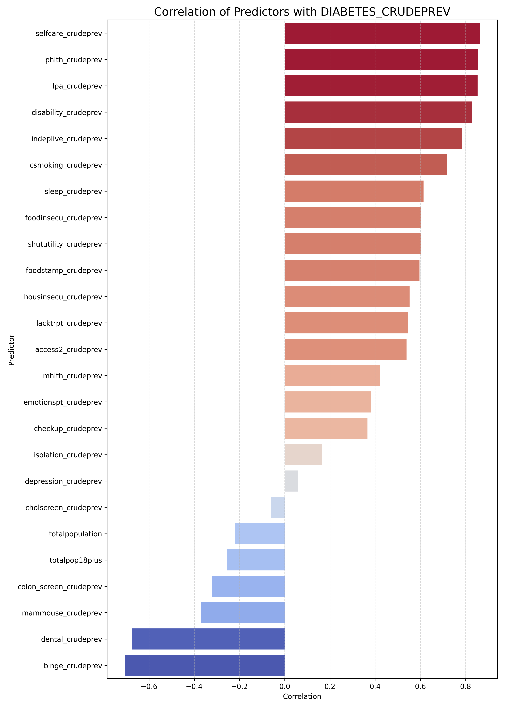

<div align="center">

# CDC Chronic Health Risk Model

A two-phase ML pipeline that predicts 10 chronic disease rates across **73,000+ U.S. census tracts** — then compresses them into a single geographic risk index, visualized on a live interactive map.

[](https://venubandi.github.io/cdc-chronic-health-risk/)
[](https://github.com/VenuBandi/cdc-chronic-health-risk/stargazers)

[](https://pytorch.org)
[](https://scikit-learn.org)
[](https://www.cdc.gov/places/index.html)
[](LICENSE)

</div>

<br>


---

## Results at a Glance

Separate Random Forest and Gradient Boosting models were tuned per disease. RF and GB differed by ≤ 0.01 R²; RF was chosen for interpretable feature importances.

| Disease | Test R² |
|:--|:--:|
| COPD | **0.977** |
| Stroke | **0.971** |
| Diabetes | **0.960** |
| Arthritis | **0.951** |
| Cancer | **0.950** |
| CHD | **0.934** |
| BP Medication | **0.930** |
| Hypertension | **0.927** |
| Obesity | **0.887** |
| High Cholesterol | **0.863** |

<table>
<tr>
<td></td>
<td></td>
</tr>
<tr>
<td align="center">Random Forest R² — train vs. test</td>
<td align="center">Top predictors for diabetes</td>
</tr>
</table>

---

## What the Model Found

High accuracy alone is easy to dismiss. The interesting result is *what* the model learned. Feature importance analysis revealed three clinically distinct mechanisms:

### 1 · Detection Effects — Hypertension, High Cholesterol, Cancer
The strongest predictor is **screening and checkup rates** — not lifestyle factors.

These conditions are largely asymptomatic. Communities with low healthcare access have *undiagnosed* disease, not lower disease prevalence. The model picked up this access signal exactly as epidemiologists would expect.

### 2 · Burden Signals — Stroke, COPD, CHD
The strongest predictor is **poor physical health days** — a consequence, not a cause.

COPD causes severe fatigue and dyspnea (GOLD 2023). Stroke leaves lasting disability (AVAIL Registry). The model captured the lived burden of these diseases, not just their prevalence.

### 3 · Socioeconomic Clustering — Diabetes, Obesity
- **Diabetes**: Self-care disability is the #1 predictor (importance ≈ 0.196). The relationship is bidirectional — neuropathy causes disability, and disability worsens glycemic control (NIH/CDC).
- **Obesity**: Smoking prevalence is the #1 predictor (importance ≈ 0.230). Not because smoking causes obesity — both cluster in socioeconomically disadvantaged neighborhoods (PMC4948154). Post-cessation weight gain averages 4–5 kg (meta-analysis of 63,403 quitters).

---

## Phase 2 — Chronic Health Risk Index (CHRI)

Chronic diseases co-occur: the same census tracts carry elevated stroke *and* COPD *and* diabetes. A single-disease model misses this multimorbidity signal.

**Architecture:** `Input(10) → FC(32)+ReLU → FC(16)+ReLU → Output(1)` · 897 parameters

A linear network was tried first (mathematically equivalent to linear regression — rejected). The nonlinear architecture captures interaction effects between co-occurring conditions.

**Output:** CHRI score normalized to 0–100, segmented into Low / Medium / High risk tiers.

**Risk tier characteristics:**

| Tier | Profile |
|:--|:--|
| **Low** | Modest disease burden, strong preventive care access, stable metabolic indicators |
| **Medium** | Mixed cardiometabolic burden, partial care engagement |
| **High** | Elevated cardiometabolic burden, unmanaged chronic illness, low preventive-care engagement |

Anchor variables driving CHRI upward: Stroke, CHD, COPD, Hypertension — clustering together via aging, poor healthcare access, and socioeconomic stress.

---

## Interactive Map

Every U.S. census tract colored by composite risk tier. Zoom into any neighborhood.

**[→ Open the live map](https://venubandi.github.io/cdc-chronic-health-risk/)**

---

## Pipeline

```
CDC PLACES 2024 (73k tracts · 25 predictors · 10 targets)
        ↓
  Preprocessing — standardization · mean imputation · StandardScaler
        ↓
  Phase 1 — 10 × (RF + GB) models, tuned independently per disease
        ↓
  Feature importance — medical validation of learned mechanisms
        ↓
  Phase 2 — CHRI neural network (897 params · loss 0.065)
        ↓
  Risk tier classification — Low / Medium / High (quantile)
        ↓
  Interactive choropleth map (Folium · GitHub Pages)
```

---

## Quick Start

```bash
git clone https://github.com/VenuBandi/cdc-chronic-health-risk
cd cdc-chronic-health-risk
pip install -r requirements.txt
jupyter lab CDC_Chronic_Health_Risk_Model.ipynb
```

Data: [CDC PLACES 2024](https://www.cdc.gov/places/index.html) — download the census-tract CSV and place it in the repo root before running.

---

## Tech Stack

`Python` `PyTorch` `scikit-learn` `pandas` `Folium` `Jupyter`

---

<div align="center">

If this project was useful or interesting, a ⭐ helps others find it.

</div>
