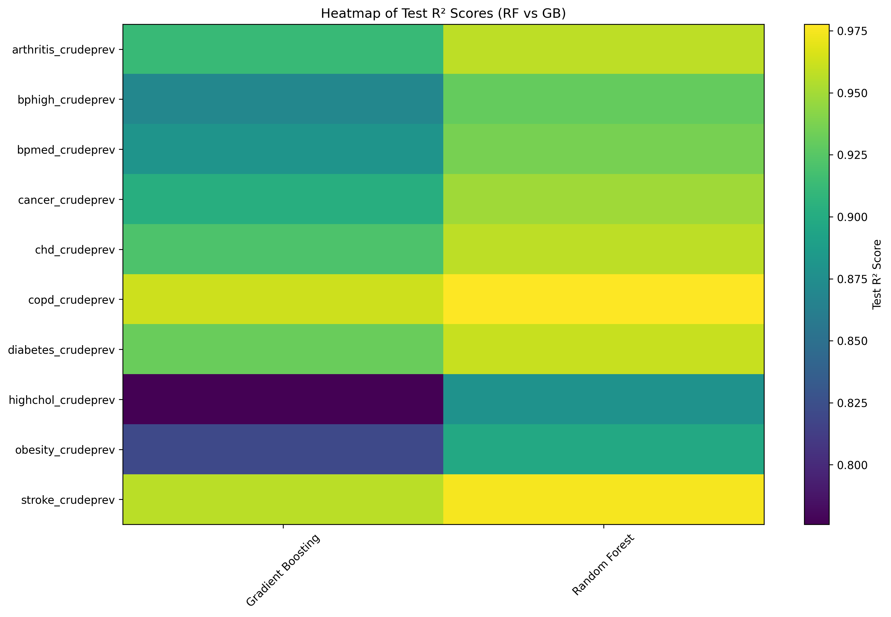
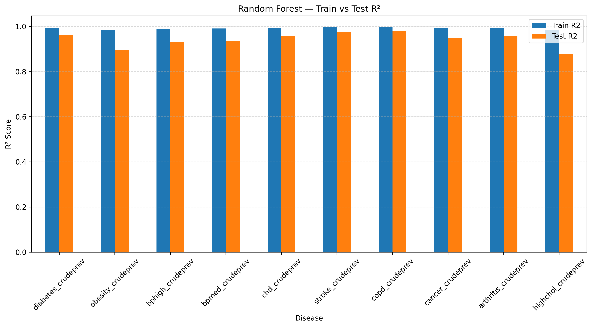
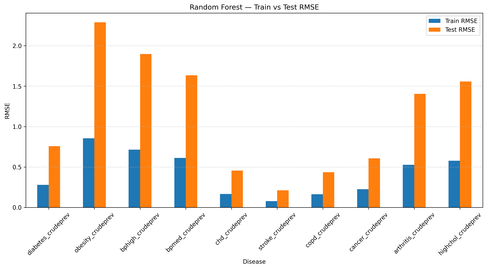

# CDC Chronic Health Risk Model

Predicting chronic disease burden across 73,000+ U.S. census tracts — Random Forest, Gradient Boosting, and a neural-network Chronic Health Risk Index.

[](https://pytorch.org)
[](https://www.cdc.gov/places/index.html)

---

**[🗺️ Launch Interactive U.S. Disease Risk Map →](https://venubandi.github.io/cdc-chronic-health-risk/)**

---



## Results

Both models predict chronic disease rates with R² > 0.90 on held-out data.

| Model | Avg Test R² | Notes |
|---|---|---|
| Tuned Random Forest | ~0.90+ | Best interpretability across all 10 diseases |
| Tuned Gradient Boosting | Comparable | Less interpretable, more noise-sensitive |

Top predictors by disease (Random Forest feature importance):

| Disease | Key Drivers |
|---|---|
| Diabetes | Self-care disability, physical inactivity, obesity |
| COPD | Smoking, inactivity, lack of preventive care |
| Hypertension | Obesity, low checkup rates, socioeconomic stress |
| Stroke / CHD | BP medication, smoking, aging indicators |

The neural-network CHRI compresses 10 disease dimensions into a 0–100 risk score. Tracts in the **High** tier show 2–3× higher prevalence of stroke, COPD, and CHD vs the **Low** tier.

<table>
<tr>
<td></td>
<td></td>
</tr>
<tr>
<td align="center">Random Forest R²</td>
<td align="center">Random Forest RMSE</td>
</tr>
</table>

## Pipeline

**Phase 1 — Regression** · 10 chronic disease targets · 25 behavioral and social predictors · per-disease Random Forest and Gradient Boosting with GridSearchCV

**Phase 2 — CHRI Index** · PyTorch feed-forward network (10→32→16→1) · composite risk score 0–100 · risk tier classification → Folium interactive census tract map

## Quick Start

```bash
git clone https://github.com/VenuBandi/cdc-chronic-health-risk
cd cdc-chronic-health-risk
pip install -r requirements.txt
jupyter lab CDC_Chronic_Health_Risk_Model.ipynb
```

Data: [CDC PLACES 2024](https://www.cdc.gov/places/index.html) → place the CSV in the repo root before running.

## License

MIT
